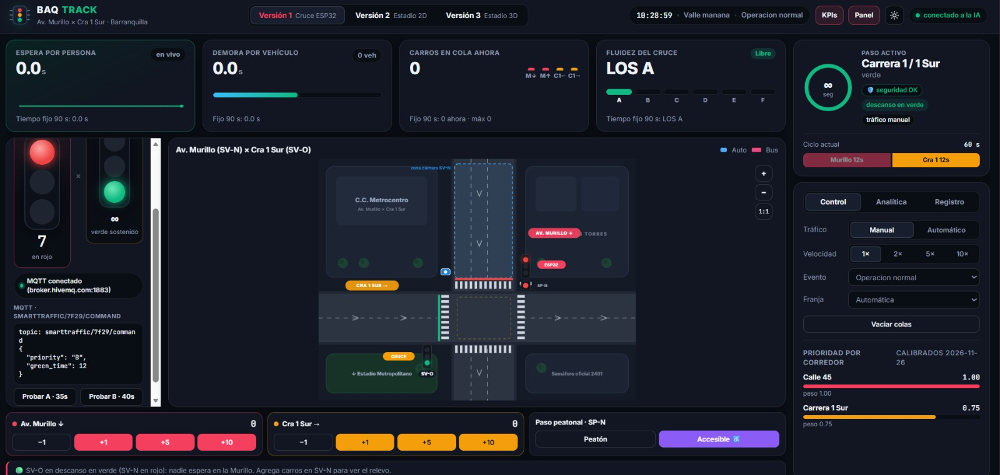

# backtrack

**Semáforos que dan paso a todos.**

Landing page del proyecto **backtrack**, una propuesta de semáforos inteligentes y cruces accesibles para Barranquilla. Desarrollada por **IngeniaCity** para **QuiJAM 2034**, con el respaldo de la Corporación Universitaria Americana.

La página presenta el problema, la arquitectura técnica del sistema, el prototipo interactivo, el plan de escalamiento y el equipo detrás de la idea.

- **Prototipo:** https://baqtrack.vercel.app/
- **Sitio:** HTML, CSS y JavaScript estáticos, sin dependencias ni paso de compilación.



## La propuesta en breve

Barranquilla opera hoy con semáforos de tiempos fijos: una calle vacía y una con cola esperan el mismo verde. backtrack propone una red que observa el flujo real y decide en consecuencia.

| Etapa | Qué ocurre |
| --- | --- |
| **Detectar** | Cuatro cámaras y cuatro Raspberry Pi cuentan vehículos por tipo en cada acceso. |
| **Conectar** | Un switch y un router 4G/5G envían los conteos en JSON por MQTT. |
| **Decidir** | La central calcula nuevos tiempos según las colas y las prioridades del sector. |
| **Aplicar** | El PLC controla las luces respetando mínimos, máximos y fases de seguridad. |

El video se procesa en la intersección: hacia la central viajan conteos, no imágenes ni placas. Si la conexión cae, el semáforo conserva su plan, puede volver a ciclo fijo y guarda los conteos localmente para sincronizarlos después.

Además del tráfico general, el sistema prioriza **emergencias**, **transporte masivo** y **cruces extendidos** para personas con movilidad reducida.

## Cifras del proyecto

| Indicador | Valor |
| --- | --- |
| Piloto (2027–2028) | 6 intersecciones en el sector Metropolitano |
| Fase Mundial (2029–2033) | 28 intersecciones en zonas concurridas |
| Extensión ciudad (desde 2035) | 280 intersecciones |
| Consumo estimado | ~97 W por intersección |
| Generación solar | 2 paneles de 450 Wp (900 Wp) |
| Batería opcional | 7 kWh |
| Inversión fases 1 y 2 | COP 1.511–1.885 M (34 intersecciones, con 10 % de contingencia) |

> Cifras preliminares del equipo, sujetas a ingeniería de detalle y cotizaciones.

## Estructura del repositorio

```text
.
├── index.html      # Página completa: hero, reto, propuesta, arquitectura, prototipo, plan y equipo
├── styles.css      # Estilos base, layout y responsive
├── theme.css       # Tokens de color, tipografía y variantes visuales
├── script.js       # Menú accesible, pestañas de prioridad y diálogo de video
├── img/            # Logos, retratos, diagramas, capturas y videos en 720p
└── README.md
```

`docs/` contiene material de trabajo local (documento técnico, pitch y video original) y está excluido del repositorio mediante `.gitignore`.

## Ver el sitio localmente

No requiere instalación. Abre `index.html` en el navegador:

```bash
xdg-open index.html   # Linux
open index.html       # macOS
start index.html      # Windows
```

Para servir los videos con soporte completo de rangos HTTP, usa un servidor local:

```bash
python3 -m http.server 8000
```

Luego visita http://localhost:8000.

## Despliegue

El sitio es completamente estático, por lo que puede publicarse en cualquier hosting de archivos:

- **GitHub Pages:** activa Pages sobre la rama `main` y la raíz del repositorio.
- **Vercel / Netlify:** importa el repositorio y publica sin comando de build.

## Accesibilidad y rendimiento

- Enlace «Saltar al contenido», navegación por teclado y foco gestionado en el menú.
- Menú modal con `aria-modal`, cierre con `Escape` y bloqueo de fondo mediante `inert`.
- Pestañas de prioridad con roles ARIA y navegación por teclado.
- Imágenes con texto alternativo y carga diferida (`loading="lazy"`).
- Videos en 720p optimizados para el repositorio; se cargan solo al abrirlos (`preload="none"`).
- Tipografías de Google Fonts con precarga de conexión.

## Equipo

| Integrante | Rol |
| --- | --- |
| Luis Barbosa | Director tecnológico |
| Juan Gómez | Director de estrategia y desarrollo de negocio |
| Luis Núñez | Director de inteligencia artificial |
| José Nieto | Líder de desarrollo de software |
| Melissa Benítez | Líder de seguridad operacional y gestión de riesgo |

## Alcance

Esta landing presenta una propuesta y una simulación de la lógica del sistema. **No representa una instalación en vía pública.** Las fuentes citadas en el documento técnico son la [Alcaldía de Barranquilla](https://barranquilla.gov.co/documento/tiempos/?version=1) y [El Universal (abril de 2026)](https://www.eluniversal.com.co/regional/atlantico/2026/04/15/alcaldia-instalo-16-botoneras-en-lugares-estrategicos-de-barranquilla/).

---

IngeniaCity · QuiJAM 2034 · Barranquilla, Colombia
